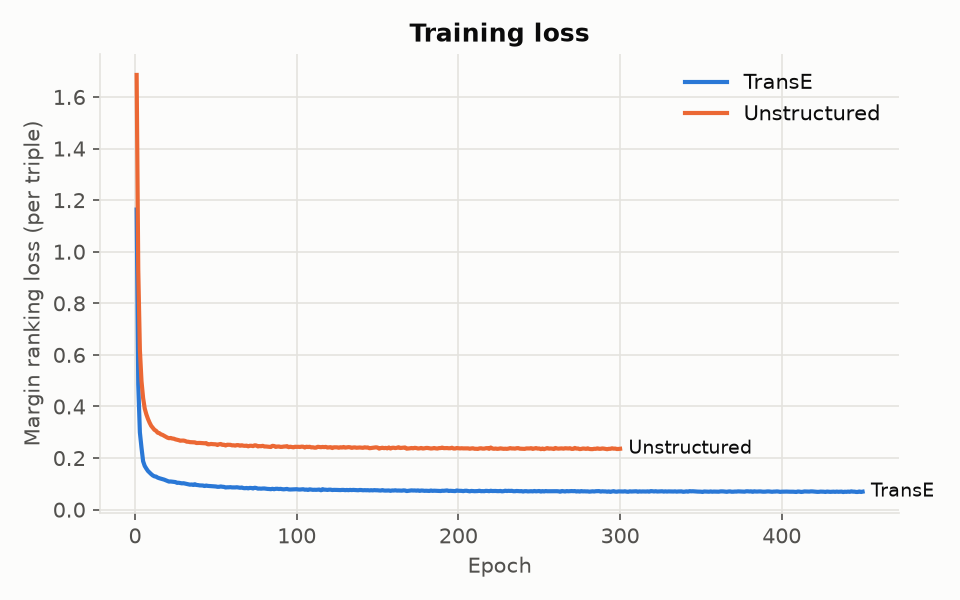
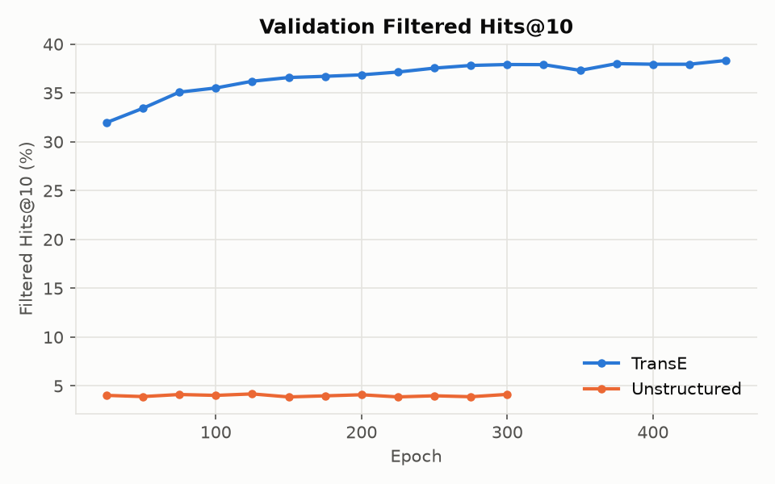
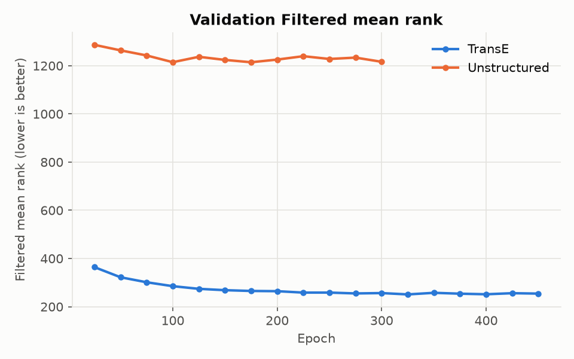

# 報告大綱：以 TransE 學習知識圖譜表示，並以非監督方法分析其結構

> 【】中的內容是寫作提示；數字來自 `results/metrics.md` 與 `results/analysis/analysis.md`。

## 1. 動機

- 知識圖譜（KG）把事實存成三元組 (head, relation, tail)，例如 (Stanford University, located_in, California)。
  - KG 永遠不完整，所以需要 link prediction：自動補上缺少的邊。
- 離散符號不好直接拿來計算。把實體和關係「嵌入」到連續向量空間後：
  - 可以用距離推論新事實；
  - 也可以用課程教的非監督方法（分群、降維）觀察空間裡的結構。
- 本報告要回答的問題：
  1. 從零實作的 TransE 能不能重現論文的趨勢？
  2. 「平移」這個設計到底帶來多少幫助？（和 Unstructured 比較）
  3. 訓練時完全沒看過類型標籤，學到的向量空間會不會自己長出「類型」結構？

## 2. 方法：TransE

### 2.1 核心想法
- 若 (h, ℓ, t) 成立，則 **h + ℓ ≈ t**：關係是向量空間中的平移。
- 距離 d(h + ℓ, t) 用 L1 或 L2。
- 【配圖：二維示意圖，畫出 h、ℓ、t 三個向量】

### 2.2 目標函數（論文 Eq.(1)）
- L = Σ_(正樣本) Σ_(負樣本) [γ + d(h+ℓ,t) − d(h'+ℓ,t')]_+
- 意思：正確三元組的距離，至少要比錯誤三元組小 γ（margin）。
- 這是 margin ranking loss，和 SVM 的 hinge loss 很像。

### 2.3 負樣本（論文 Eq.(2)）
- 隨機把 head 或 tail（不同時）換成任意實體。
- 限制：換出來的負樣本可能其實是對的。這也是為什麼評估時需要 filtered 設定。

### 2.4 訓練演算法（論文 Algorithm 1）
- 初始化：uniform(−6/√k, 6/√k)，關係向量正規化一次。
- 每次迭代先把實體向量正規化到 L2 norm = 1。
  - 為什麼需要：否則模型只要把向量放大，就能讓 loss 變小，學到的東西沒有意義。
- 抽 minibatch，產生負樣本，用 SGD 更新。

### 2.5 Baseline：Unstructured
- 拿掉平移項（ℓ = 0），只要求 h ≈ t。
- 等於所有關係共用同一種「靠近」，無法區分「出生於」和「死於」。

### 2.6 評估方式
- 對每個測試三元組，把 head（或 tail）換成全部 14,541 個實體，依距離排名。
- Mean Rank：正確答案的平均名次。Hits@10：正確答案排進前 10 名的比例。
- raw 與 filtered 的差別：
  - 若 (h, ℓ, t') 本身也是事實，t' 排在正確答案前面不該算錯。
  - filtered 會先把這些候選移除。
- 另外附 MRR（目前文獻的主流指標）。

## 3. 實驗設定

### 3.1 資料集：為什麼用 FB15k-237 而不是 FB15k
- FB15k 有**測試集洩漏**（Toutanova & Chen, 2015）：
  - Freebase 的很多關係成對出現，互為反向。例如 `/film/film/directed_by` 與 `/film/director/film`。
  - 測試集的 (h, r, t) 常常在訓練集裡就有反向版本 (t, r⁻¹, h)。
  - 所以模型只要記住「r 的反向是 r⁻¹」就能答對，不需要真的推理。
  - Toutanova & Chen 用一個只看反向關係的簡單規則模型，就在 FB15k 上贏過多數 embedding 方法。
- FB15k-237 的修正：
  - 刪掉近似重複、互為反向的關係，從 1,345 種剩 237 種；
  - 刪掉驗證集、測試集中，實體對在訓練集已經直接相連的三元組。
- 統計：14,541 實體、237 關係，訓練 / 驗證 / 測試 = 272,115 / 17,535 / 20,466。
- 結果：FB15k-237 的分數會比論文在 FB15k 上的低很多。這是預期中的，因為資料比較難、也比較誠實。

### 3.2 超參數搜尋
- grid：k ∈ {50, 100}、γ ∈ {1, 2, 5}、距離 ∈ {L1, L2}、學習率 0.01，共 12 組。
  - 論文的 grid 是 λ ∈ {0.001, 0.01, 0.1}、γ ∈ {1, 2, 10}、k ∈ {20, 50}。
  - 縮小範圍是因為計算時間有限；學習率固定為論文在 FB15k 選的 0.01。
- 每組訓練 100 epoch，依驗證集 filtered MR 選最佳組合（論文用驗證集 mean rank）。
- 最佳組合訓練最多 1000 epoch。每 25 epoch 驗證一次，連續 5 次沒進步就停止。
- TransE 與 Unstructured 用同一個 grid 各自調參，比較才公平。
- 硬體：RTX 4060 Laptop 8GB。總時間：
  - grid search 24 組共約 12 分鐘；
  - 正式訓練 TransE 約 3 分鐘、Unstructured 約 2 分鐘；
  - 非監督分析約 5 分鐘。
- 其他設定：minibatch 2048、SGD、亂數種子 42。

## 4. 結果

### 4.1 Link prediction

| 模型 | Raw MR | Raw Hits@10 | Filt. MR | Filt. Hits@10 | Filt. MRR |
|---|---|---|---|---|---|
| TransE（k=50, γ=2, L1） | 429 | 28.5% | 265 | 37.8% | 0.219 |
| Unstructured（k=50, γ=2, L1） | 1411 | 2.9% | 1255 | 4.0% | 0.020 |

- **平移項的作用：** filtered Hits@10 從 4.0% 提升到 37.8%，約 9 倍；MR 從 1255 降到 265。
  - Unstructured 只能學到「相連的實體要靠近」，不知道問的是哪一種關係。
  - 例如問「X 出生在哪裡」，它只能回答「和 X 有關的實體」，可能是 X 演過的電影。
- **raw 與 filtered 的差距：** 約 9 個百分點（28.5% vs 37.8%）。
  - 意思是有相當多的「錯誤」其實是排在前面的其他正確答案。
  - N-N 關係多的資料集尤其明顯（FB15k-237 有 108 / 237 個關係是 N-N）。
- **和文獻比較：**
  - 論文在 FB15k 上 TransE 的 filtered Hits@10 為 47.1%。
  - 我們在 FB15k-237 得到 37.8%。比較低是預期中的：FB15k-237 拿掉了反向關係這條捷徑。
  - 文獻中 FB15k-237 的 TransE 數字大約落在 40%–47%。我們較低的可能原因：
    - grid 較小，k 最多 100；
    - 照論文用純 SGD 與均勻負樣本，沒用 Adam 或 Bernoulli 抽樣等後來的技巧；
    - 只用 100 epoch 篩選超參數。
  - 這點放進限制一節說明。

### 4.2 訓練過程

  
  
  

- loss 在前 20 個 epoch 快速下降，之後緩慢收斂。
  - TransE 的最終 loss 約 0.07，Unstructured 約 0.24。
  - Unstructured 的 loss 降不下去，因為它根本無法同時滿足所有關係。
- TransE 驗證集 filtered MR 在第 325 epoch 最佳，第 450 epoch 觸發 early stopping。
- **觀察：MR 與 Hits@10 不一定同步。**
  - MR 在第 325 epoch 後就不再進步，但 Hits@10 到第 450 epoch 仍緩慢上升（38.3%）。
  - 原因：MR 對少數排名極差的離群值很敏感；Hits@10 只看前 10 名。
  - 用哪個指標做 early stopping，會影響最後的模型。

### 4.3 超參數的影響（grid search，驗證集）
- **L1 與 L2：**
  - γ=1 時兩者差不多（filtered MR 290–409）。
  - γ ≥ 2 時 L2 明顯變差（MR ~555），而且 **γ=2 與 γ=5 的結果完全一樣**。這是很好的觀察：
    - 可以證明：負樣本只換掉一端（例如 t → t'），由三角不等式
      |d(h+ℓ, t) − d(h+ℓ, t')| ≤ ‖t − t'‖₂ ≤ ‖t‖₂ + ‖t'‖₂ = 2（實體向量是單位長度）。
    - 所以 γ ≥ 2 時，γ + d_pos − d_neg ≥ 0 對所有樣本都成立：hinge 永遠不會等於 0，loss 退化成線性。
    - 這時梯度與 γ 無關，同樣的亂數種子就會得到同樣的結果。
    - 換句話說：**margin 必須和距離的尺度相配**，否則 margin ranking loss 就失去「只修正違規樣本」的作用。
  - L1 距離的上界是 ‖t − t'‖₁ ≤ 2√k（k=50 時約 14），所以 γ=2、5 仍然有效。
- **維度：** k=50 與 k=100 差距不大。在 100 epoch 的篩選下，k=50 收斂較快、略好。

### 4.4 依關係類型分析（對應論文 Table 4，filtered Hits@10）

| 模型 | 預測 | 1-1（17 關係） | 1-N（26） | N-1（86） | N-N（108） |
|---|---|---|---|---|---|
| TransE | head | 52.6% | 55.0% | **8.2%** | 29.9% |
| TransE | tail | 50.0% | **6.4%** | 79.0% | 42.9% |
| Unstructured | head | 47.4% | 1.0% | 1.7% | 3.9% |
| Unstructured | tail | 46.4% | 1.0% | 1.9% | 4.8% |

- 預測「只有一個答案」的那一邊很準：1-N 的 head 55.0%、N-1 的 tail 79.0%。
- 預測「有很多答案」的那一邊很差：1-N 的 tail 6.4%、N-1 的 head 8.2%。
- 這和論文 Table 4 的趨勢一致，詳見 6.1 節。
- 有趣的是，1-1 關係上 Unstructured 也有 47%。
  - 原因：1-1 關係的兩端在圖上通常只有彼此，「找最近的實體」就夠了。

## 5. 非監督分析

### 5.1 方法
- 輸入：訓練好的 14,541 個實體向量（已正規化）。
- K-means：k 從 2 掃到 40，用 elbow 與 silhouette 選 k。
- 類型標籤：
  - 來源是 TKRL（Xie et al., 2016）整理的 Freebase types，依優先規則歸成 10 類加上 other。
  - **完全沒有參與訓練或分群**，只用來事後評估。
- 外部指標：
  - purity：每群的多數類型佔多少；
  - NMI：與類型的資訊重疊程度；
  - ARI：修正了「隨機分群也有一定分數」的問題。
- 對照組：隨機分群。
- 降維：PCA（線性，保留全域變異）與 t-SNE（非線性，保留鄰居關係），畫成 small multiples。

### 5.2 結果

| 實體向量 | 分群設定 | k | Purity | NMI | ARI |
|---|---|---|---|---|---|
| TransE | k = 類型數 | 11 | 0.801 | 0.644 | 0.412 |
| TransE | silhouette 最佳 | 40 | 0.891 | 0.600 | 0.204 |
| Unstructured | k = 類型數 | 11 | 0.595 | 0.374 | 0.230 |
| Unstructured | silhouette 最佳 | 2 | 0.391 | 0.199 | 0.155 |
| 隨機分群 | - | 11 | 0.310 | 0.002 | 0.000 |

- **選 k 的困難（kmeans_k_scan.png）：**
  - TransE 的 silhouette 都只有 0.08–0.10，而且隨 k 增加緩慢上升。最高點在掃描範圍邊界 k=40，沒有明顯峰值。
  - elbow 曲線也很平滑，沒有明顯的「肘」。
  - 原因：所有向量都在 50 維單位球面上，群與群之間沒有清楚的空白；而且類型本身有階層（人 → 演員 / 作家 / 音樂家）。
  - 這是非監督方法的真實困難，報告可以據實寫：內部指標（silhouette）和外部指標（NMI）不一定一致。
- **k=40 時 purity 更高（0.89），但 NMI、ARI 較低。** 因為 TransE 把大類切得更細：
  - 「人」分成好萊塢演員、導演 / 製片、作家哲學家、搖滾樂手、喜劇演員、影集演員……
  - 每群都很純，但一個類型被切成好幾群，所以 NMI、ARI 下降。
  - 這說明向量空間學到的是**比我們的 10 類更細的結構**。
- **TransE vs Unstructured：**
  - TransE 的 NMI 0.644，遠高於 Unstructured 的 0.374。
  - 在 t-SNE 圖中，Unstructured 的獎項、類型（genre）、電視節目、職業幾乎散落各處；TransE 則各自成團。
  - 原因：Unstructured 只要求「相連的實體要靠近」，所以「某部電影」會靠近「它的導演」與「它得的獎」，不同類型的實體被拉在一起。
  - TransE 的不同關係有不同平移向量，同一類型、扮演同一關係角色的實體會被推到相似位置。
- **PCA vs t-SNE：**
  - PCA 前兩主成分只解釋 8.7% + 5.8% 的變異，所以 PCA 圖中類型大量重疊。
  - t-SNE 保留局部鄰居關係，類型分得很清楚。
  - 意思是結構存在，但分布在很多維度上，不是線性的。

### 5.3 質性分析（k=40，摘自 results/analysis/transe/clusters.md）
- **Cluster 1（744 個，100% 球隊）：** Swindon Town F.C.、FC Shakhtar Donetsk、Macedonia national football team……
  - 國家隊和職業足球俱樂部混在一起，因為它們在圖上參與的關係（球員效力、聯賽）相同。
- **電影被分成風格不同的群：**
  - Cluster 38：The Queen、Gosford Park、Babel、The Iron Lady、An Education，偏「獎季文藝片」；
  - Cluster 2：Spider-Man 3、Terminator 3、Transformers: Revenge of the Fallen、2012，偏「好萊塢大片」；
  - Cluster 24：Zoolander、Talladega Nights、Little Fockers，偏「美式喜劇」。
  - 圖譜裡沒有「風格」這種標籤。模型是從共同的演員、提名的獎項、類型等連結自己學出來的。
- **人被分成職業群：**
  - Cluster 20：Tolstoy、Sartre、Goethe、Camus、Deleuze，作家 / 哲學家；
  - Cluster 16：Jimi Hendrix、Bob Dylan、Carlos Santana，搖滾樂手；
  - Cluster 30：Jay Leno、Jerry Seinfeld、Conan O'Brien，喜劇 / 脫口秀。
- **地點依地理與層級分群：**
  - Cluster 29：美國的郡（Chester County、Baltimore County……）；
  - Cluster 18：美國西南部城市（San Diego、Phoenix、Dallas）；
  - Cluster 12：英國的行政區，和英國大學混在一起，因為大學和城市常透過「位於」關係相連。
- **混雜的群也有規律：**
  - Cluster 17 混合奧運（1908、1924 Summer Olympics）與戰爭（Peninsular War、Second Crusade）。兩者都是「歷史事件」，在圖上用相似的關係（參與國、年代）連結。
  - Cluster 21 混合疾病（Stroke、HIV、Malaria）與電影類型（Melodrama、Prison film）。兩者都常當成電影的「主題 / 類型」，而且都是被很多實體指向的 tail。

### 5.4 為什麼沒看過類型，卻能分出類型？
- 同一類實體會出現在相同關係的相同位置（人常是 `born_in` 的 head、城市常是 tail）。
- 要滿足 h + ℓ ≈ t，這些實體的向量就被推到相似的區域。
- 所以類型結構是 link prediction 目標的「副產品」。

## 6. 限制

### 6.1 一對多 / 多對一 / 多對多關係（最重要）
- 若 (h, ℓ, t₁) 與 (h, ℓ, t₂) 都成立，h + ℓ ≈ t₁ 且 ≈ t₂，於是 t₁ ≈ t₂。
  - 例如「某演員演過的所有電影」都被迫擠到同一點。
- 實驗證據（4.4 節）：預測「多」的那一邊表現明顯較差。
  - 1-N 的 tail 只有 6.4%，而 head 有 55.0%；
  - N-1 的 head 只有 8.2%，而 tail 有 79.0%。
- 後續方法的改進：
  - TransH：投影到關係專屬的超平面；
  - TransR：關係專屬空間；
  - RotatE：複數空間中的旋轉，可處理對稱、反向、組合關係。

### 6.2 對稱關係
- 若 r 對稱，h + ℓ ≈ t 且 t + ℓ ≈ h，推出 ℓ ≈ 0，退化成 Unstructured。

### 6.3 負樣本
- 均勻隨機替換會產生很多太容易分辨的負樣本，也可能產生「其實是對的」負樣本。
- 改進方向：TransH 的 Bernoulli 抽樣、self-adversarial sampling。

### 6.4 實驗本身的限制
- grid 比論文小，學習率固定，只跑一個亂數種子（沒有標準差）。
- 結果比文獻中調得較好的 TransE 低。可能原因：
  - 篩選只跑 100 epoch，偏好收斂快的設定；
  - 用純 SGD；
  - 用 MR 做 early stopping（Hits@10 其實還在進步）。
- margin 與距離尺度的交互作用：L2 搭配 γ ≥ 2 會讓 loss 退化（見 4.3 節）。
  - 如果重做，L2 應該搜尋更小的 γ，例如 {0.25, 0.5, 1}。
- 類型標籤是用規則從 Freebase types 歸納出來的，本身就有雜訊。
- t-SNE 圖中群的大小與距離沒有意義，不宜過度解讀。

## 7. 結論
1. **平移項的作用：**
   - 從零實作的 TransE 在 FB15k-237 達到 filtered Hits@10 37.8%、MR 265、MRR 0.219；
   - Unstructured 只有 4.0% / 1255 / 0.020，證明「關係 = 平移」是 TransE 有效的關鍵。
2. **類型結構自己長出來：**
   - 訓練時完全沒有類型監督，但 K-means 分群與 Freebase 類型的 NMI 達 0.644（隨機為 0.002）；
   - 質性分析還看到比類型更細的結構，例如電影的風格、人的職業。
   - 這說明 link prediction 的目標會讓「扮演相同關係角色」的實體自然聚在一起。
3. **一對多問題：**
   - 依關係類型的分析重現了論文指出的一對多問題（1-N 的 tail 只有 6.4%）；
   - 這正是後續 TransH / TransR / RotatE 的出發點。

## 參考文獻
- Bordes, A., Usunier, N., Garcia-Durán, A., Weston, J., & Yakhnenko, O. (2013). Translating embeddings for modeling multi-relational data. *NeurIPS*.
- Toutanova, K., & Chen, D. (2015). Observed versus latent features for knowledge base and text inference. *3rd Workshop on Continuous Vector Space Models and their Compositionality*.
- Xie, R., Liu, Z., & Sun, M. (2016). Representation learning of knowledge graphs with hierarchical types. *IJCAI*.（TKRL，類型資料來源）
- Wang, Z., Zhang, J., Feng, J., & Chen, Z. (2014). Knowledge graph embedding by translating on hyperplanes. *AAAI*.（TransH）
- van der Maaten, L., & Hinton, G. (2008). Visualizing data using t-SNE. *JMLR*.
